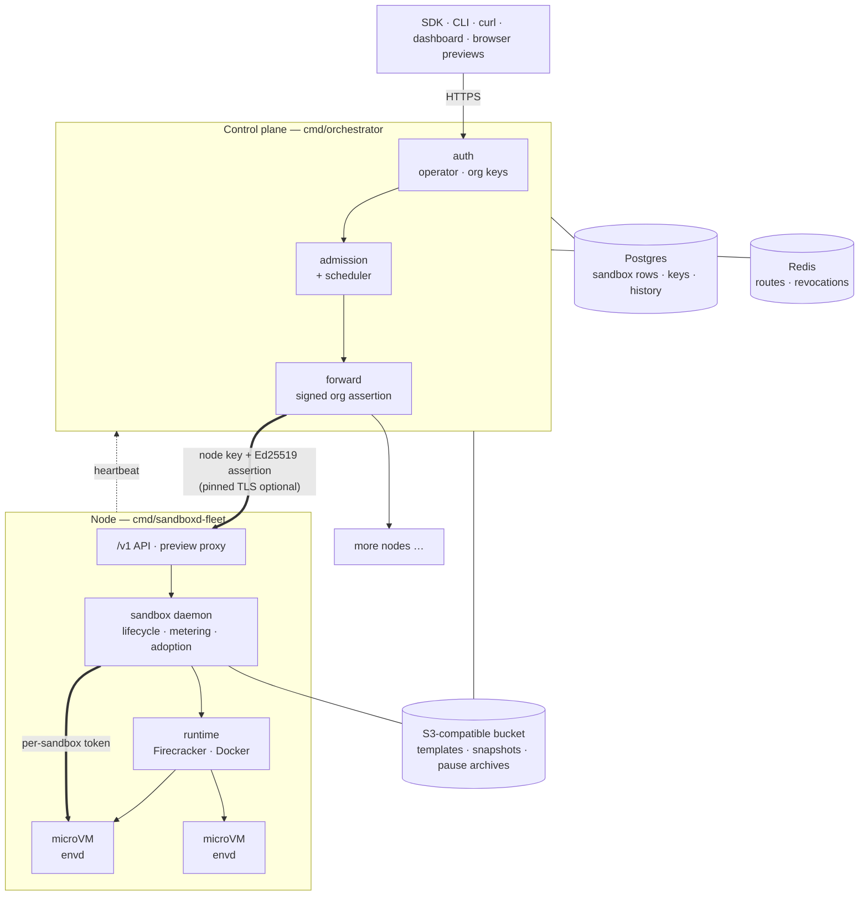

# PillDrops

**A self-hosted engine for running untrusted code in isolated machines, one
HTTP API from a laptop to a fleet.**

Give it a Linux host with KVM and it runs every sandbox in its own Firecracker
microVM, with its own kernel. You create a sandbox in one API call, run
commands, move files, open a terminal, expose a port as a URL, and then pause
it, copy it, roll it back or move it to another machine without losing a byte
of its memory. Add more hosts and a control plane, and the same API schedules
across all of them and brings paused sandboxes back when a host dies.

> ⚠️ **This software runs untrusted code.** Isolation and egress controls are
> central to its design. Read [`SECURITY.md`](SECURITY.md) before exposing it,
> and never run the anonymous dev mode on a shared or public host.

---

## What it provides

### Run code, safely

- **A microVM per sandbox.** Firecracker on Linux + KVM: each sandbox has its
  own kernel, a jailed VMM running as a uid of its own, in its own network
  namespace. A Docker runtime is available where KVM is not (shared kernel,
  stated plainly), and a bare-process runtime for local development only.
- **Refuses to run without isolation.** A node that finds neither Firecracker
  nor Docker will not start, rather than run tenant code on the bare host.
- **Everything a program needs from outside:** exec with streaming output,
  files and directories, a directory watch, process list and signals, an
  interactive PTY over WebSocket, the list of ports a program is listening on.
- **Templates.** Python, Node, Go, browsers, desktops, coding agents and more
  in [`templates/`](templates/); add your own by publishing an image, with no
  code change ([template registry](docs/template-registry.md)).

### Keep state, not just output

- **Pause and resume** with memory and running processes intact. A paused
  sandbox costs disk, not RAM.
- **Idle hibernation.** A sandbox left alone pauses itself and wakes on the
  next request, with its data.
- **[Checkpoints](docs/checkpoints.md):** named save points you roll a sandbox
  back to, in place.
- **[Fork](docs/fork.md):** copy a running sandbox, memory and processes
  included, in milliseconds; the copy is copy-on-write.
- **[Named snapshots](docs/snapshots.md):** set a machine up once, save it, and
  start new sandboxes that wake with the work already done.
- **Backups** of a sandbox's disk to object storage.

### Scale out, and survive a lost machine

- **A control plane** that places each sandbox on the best-fitting node,
  spreads load away from busy hosts, retries elsewhere when a node is full,
  and proxies every request to the node that owns the sandbox.
- **Move** a running sandbox to another node under the same id and URL, or
  drain a node for maintenance.
- **Resume anywhere.** With a bucket configured, every pause is archived. When
  a node dies, its paused sandboxes resume on another node on first use. With
  lazy memory the VM runs before its memory has downloaded: measured at 2.8 s
  for a 4 GB sandbox, and ten at once in 3 s, on a two-node test fleet.
- **A sandbox that ran after its last pause is reported lost, never silently
  rolled back** to an older copy of itself.
- **Restarts lose nothing.** Stopping a node daemon pauses its sandboxes to
  disk; a crash leaves them running and the next daemon adopts them.
- **Object storage:** any S3-compatible store (verified on AWS S3, Google Cloud
  Storage and MinIO). Only blocks that hold data are stored, and root images
  are stored once per content hash.

### Reach it, and control what it reaches

- **Preview URLs** for any port, each sandbox on its own browser origin, with
  signed short-lived tokens for private previews and custom domains for public
  ones.
- **Egress policy** per org and per sandbox: allow or deny by domain or
  address, enforced outside the guest, with DNS-rebinding closed by resolving
  permitted names at the proxy.
- **Private networks** between sandboxes, and raw TCP/UDP forwarding.

### Operate it

- **One credential model.** An operator key, per-org keys, and a per-sandbox
  token for the in-guest agent. Requests between the control plane and nodes
  carry a signed, single-use org assertion; the hop can be pinned TLS.
- **Limits per org:** vCPU, memory, storage, concurrent sandboxes, session
  length. An org with no limits assigned is unlimited.
- **Metering and history:** CPU and memory time per sandbox, logs, metrics,
  audit events and webhooks.
- **A dashboard**, API docs served by the server, a CLI, Python and
  JavaScript SDKs, and an MCP server for AI agents.

### What it deliberately is not

The runtime creates sandboxes, runs code in them, meters what they use and
enforces the limits you set. It contains **no billing and no hosted identity
provider**: no payments, plans, credits or SSO. If you build a product on it,
signup and invoices belong in your layer.

---

## What it is useful for

- **AI agents that write and run code.** Give an agent a machine it cannot
  escape, let it install what it needs, pause it between turns, fork it to try
  several approaches, and roll it back when an attempt goes wrong.
- **Code execution in a product:** notebooks, playgrounds, graders, interview
  and training environments, where every user's code is untrusted.
- **Ephemeral environments:** preview a branch, run an end-to-end test suite
  with a real browser, then throw the machine away.
- **Long-lived workspaces** that sleep when idle and wake in seconds, instead
  of VMs billed around the clock.
- **Your own infrastructure:** it runs on hosts you own, with state in your
  database and bucket.

---

## Architecture



**Three tiers, two trust boundaries.** The control plane is trusted. A node is
trusted to host workloads but gets only what it needs: it cannot read tenants'
stored secrets, and its database role says so. Everything inside a sandbox is
untrusted, including `envd`, the small agent in each guest that runs commands
and moves files. Each crossing (client → control plane → node → guest) carries
its own credential, never a network position. A CI guard
(`scripts/tier-boundary-guard.sh`) fails the build if a package imports across
a tier it should not.

**A request, end to end.** `POST /v1/sandboxes` is authenticated and resolved
to an org, checked against the org's limits, and placed on the node with the
best fit that is not CPU-hot. It is forwarded with an assertion signed for that
node, method and path, which the node verifies and refuses to accept twice. The
node boots the sandbox from a golden snapshot of its template (tens of
milliseconds) or a cold boot (about a second) and returns an id, URLs and a
token. Every later call on that id is routed to the node that owns it.

**How a sandbox outlives its machine.** A pause writes the VM's memory, device
state and disk. With `SNAPSHOT_ARCHIVE=bucket` it is also archived: blocks of
zeros are skipped, the root image is referenced by hash, and a manifest is
written last so a half-written archive is never used. The archive's id is
recorded on the sandbox's row, and any later save clears it, so only the
latest pause can ever be restored. When the control plane reaps a dead node,
its paused sandboxes stay paused. The first request for one asks a healthy node
to *rehome* it: that node pulls the manifest and state and starts the VM with
its memory served on demand over userfaultfd, while the rest streams in behind
it.

**Single node or fleet, same code.** `cmd/sandboxd` is the whole thing in one
process: node, store (SQLite or Postgres), preview proxy and dashboard.
`cmd/orchestrator` plus any number of `cmd/sandboxd-fleet` nodes is the
clustered form. Both node binaries share `internal/nodeboot`.

Go deeper: [runtimes](docs/runtimes.md) (what each runtime isolates) and the
[deployment runbook](docs/deployment.md) (every setting, and how nodes, TLS,
storage and node loss fit together).

---

## Quick start

**Try it locally** (macOS or Linux, no KVM needed). `make dev` runs the
development server, `cmd/devserver`, with its local runtime: **sandbox commands
run as your user on your machine, with no isolation.** It is anonymous and bound
to 127.0.0.1, for trying the API and the dashboard only.

```bash
make dev                               # http://127.0.0.1:8080; PORT=… to change it
open http://localhost:8080/dashboard
open http://localhost:8080/docs        # API reference, served by the server
```

**Run a real node** (Linux only; KVM for Firecracker, otherwise Docker. The
node enforces egress rules with the host's `iptables`, so on macOS it starts
but refuses to create sandboxes):

```bash
make sandboxd
export SANDBOXD_DATA=/var/lib/sandboxd   # the default under $TMPDIR may be purged
sudo -E ./bin/sandboxd                   # SQLite under SANDBOXD_DATA; no other setup
```

On first start the node mints an operator API key into
`$SANDBOXD_DATA/bootstrap.key` (mode 0600) rather than logging it. Read it once,
put it in your secret manager, delete the file. The same key logs in to the
dashboard.

```bash
export PILLDROPS_API_KEY=$(sudo cat "$SANDBOXD_DATA/bootstrap.key")
curl -H "Authorization: Bearer $PILLDROPS_API_KEY" localhost:8080/v1/templates
```

`scripts/provision-node.sh` prepares a bare host for Firecracker (kernel,
Firecracker and jailer at the pinned version, templates). See
[deployment](docs/deployment.md#host-setup-per-node).

**Run a fleet.** Run `orchestrator` with Postgres and Redis, then join each
node with a one-time token, so no node's credentials are ever written by hand:

```bash
curl -X POST https://<domain>/v1/join-tokens -H "Authorization: Bearer $ORCHESTRATOR_API_KEY"
# → paste the returned bootstrap_cmd on the new host
```

Add a bucket (`ORCHESTRATOR_ARTIFACT_STORE=s3`, `SANDBOXD_ARTIFACT_STORE=s3`,
`SNAPSHOT_ARCHIVE=bucket`) and paused sandboxes survive their node. Every
setting, and the traps around each, is in the
**[deployment runbook](docs/deployment.md)**.

---

## Using it

**Deploy an app in one call:** files, setup, a start command and a port; the
response carries the preview URL.

```bash
curl -X POST localhost:8080/v1/sandboxes -H "Authorization: Bearer $PILLDROPS_API_KEY" -d '{
  "template": "python-3.11",
  "files": [{"path": "app.py", "content": "from flask import Flask\napp = Flask(__name__)\n@app.route(\"/\")\ndef index(): return \"Hello World!\"\napp.run(host=\"0.0.0.0\", port=8000)"}],
  "setup": ["pip3 install flask"],
  "start": "python3 app.py",
  "port": 8000
}'
```

**Restrict what it can reach:**

```json
{ "template": "python-3.11", "network": { "allow": ["pypi.org", "*.pythonhosted.org"] } }
```

**From Python** ([`pip install pilldrops`](https://github.com/pilldrops-oss/pilldrops-python))
or **JavaScript** ([`npm i @pilldrops/sdk`](https://github.com/pilldrops-oss/pilldrops-js)):

```python
from pilldrops import Sandbox

with Sandbox.create(template="python-3.11") as sb:
    sb.files.write("/root/app.py", "print('hello')")
    print(sb.run("python3 /root/app.py").stdout)   # hello
    sb.pause()
    sb.resume()                              # same memory, same processes
```

**From the shell:** the [`pilldrops` CLI](https://github.com/pilldrops-oss/pilldrops-cli)
(`npm i -g @pilldrops/cli`, or `curl -fsSL http://<your node>/install.sh | sh`
from a single-node `sandboxd`; a control plane's `/install.sh` joins nodes
instead) creates sandboxes, runs commands, opens a real shell and exposes ports;
see the [CLI reference](docs/pilldrops-cli.md). [`cli/pilldrops`](cli/) is an
older Python script covering a subset, kept for environments without the CLI.

**From an AI agent:** the control plane serves MCP at `/mcp`
(`claude mcp add --transport http pilldrops https://<your server>/mcp --header
"Authorization: Bearer <key>"`), and `pilldrops mcp` serves the same tools over
stdio. [Runnable examples](https://github.com/pilldrops-oss/pilldrops-examples)
cover a code interpreter, browser automation, coding agents, app previews and
evals.

### API at a glance

The server serves the full, interactive reference at `/docs`.

| Area | Endpoints |
|---|---|
| Lifecycle | `POST /v1/sandboxes` · `GET/DELETE /v1/sandboxes/{id}` · `…/pause` · `…/resume` · `…/timeout` · `…/refresh` · `…/move` |
| State | `…/checkpoints` · `…/fork` · `…/snapshot` · `…/backups` |
| Run | `…/exec` · `…/start` · `…/process` · `…/ports` · WebSocket terminal at the sandbox's `terminal_url` |
| Files | `…/files` · `…/filesystem/{list,stat,mkdir,move,remove,watch}` |
| Network | `…/preview-token` · `…/visibility` · `…/forwards` · `…/tcp` · `…/udp` |
| Observe | `…/logs` · `…/metrics` · `…/history` · `/v1/usage` · `/v1/webhooks` |
| Admin | `/v1/templates` · `/v1/keys` · `/v1/members` · `/v1/nodes` · `/v1/join-tokens` |

Agent-facing capabilities, token scopes and webhook signatures are in
[`docs/agent/`](docs/agent/).

---

## Repository layout

```
cmd/
  sandboxd/        single-node server: node + store + proxy + dashboard
  sandboxd-fleet/  fleet node agent (no web UI)
  orchestrator/    control plane: auth, admission, scheduling, forwarding, dashboard
  envd/            in-guest agent: exec, files, terminal
  agentd/          in-guest supervisor for agent templates
  devserver/       development server behind `make dev` (local, unisolated runtime)
  pilldrops-join/  node bootstrap used by a join token
  pilldrops-bench/ latency and density benchmarks
  setplan/         assign a limit preset to an org
  gendocs/         generates docs/agent from the OpenAPI document
internal/
  httpapi/         the node's /v1 API
  orchestrator/    the control plane's API, forwarding and background jobs
  cluster/         node registry and best-fit scheduler
  sandbox/daemon/  sandbox lifecycle, metering, pause archives, rehome
  runtime/         runtime adapters: firecracker, docker, process
  vm/              Firecracker engine: jailer, snapshots, networking, lazy memory
  artifact/        object storage: S3, packed block format, cache
  egress/, egressproxy/   outbound policy
  store/           SQLite / Postgres, versioned migrations
  proxy/           preview reverse proxy
  extras/          optional features (AI agent, chat bridges, functions); the
                   engine never imports them, and `-tags core` leaves them out
templates/         sandbox image recipes
web/               dashboard source
cli/               older Python CLI (the maintained CLI is pilldrops-oss/pilldrops-cli)
agent/             a small Python coding agent that drives sandboxes (example)
action/            GitHub Action: run a command in a sandbox from a workflow
examples/          API and SDK examples
tests/             contract tests against a live deployment, CLI and e2e tests
install/, packaging/  node installer and systemd units
scripts/           host provisioning, template builds, CI guards
proto/             envd's gRPC protocol
docs/              documentation, indexed in docs/README.md
```

## Building and testing

```bash
make build     # sandboxd, envd and agentd for linux/amd64
make test      # the Go test suite
make check     # everything CI runs: builds, tests under Linux, the tier,
               # unit and workflow guards, lint and the security scanners.
               # A check that could not run says SKIP, never PASS.
```

The Firecracker engine is Linux-only, so run `make check` on Linux (or let it
use a Linux host) before opening a PR. Tests that need root skip without it.
`make test` needs Go and a C compiler (the race detector uses cgo).

## Documentation

[`docs/README.md`](docs/README.md) indexes everything. Start with:

- [Deployment runbook](docs/deployment.md): every setting, node loss, object storage, upgrades
- [Runtimes](docs/runtimes.md): what each runtime does and does not isolate, checked against the code
- [Checkpoints](docs/checkpoints.md), [fork](docs/fork.md), [named snapshots](docs/snapshots.md)
- [Verifying a release](docs/releases.md): signed binaries and how to check them

## Contributing, security, license

Contributions are welcome: [`CONTRIBUTING.md`](CONTRIBUTING.md) has the
workflow, and [`CODE_OF_CONDUCT.md`](CODE_OF_CONDUCT.md) applies. Report
vulnerabilities privately as described in [`SECURITY.md`](SECURITY.md), never
in a public issue.

Licensed under the [Apache License 2.0](LICENSE).
