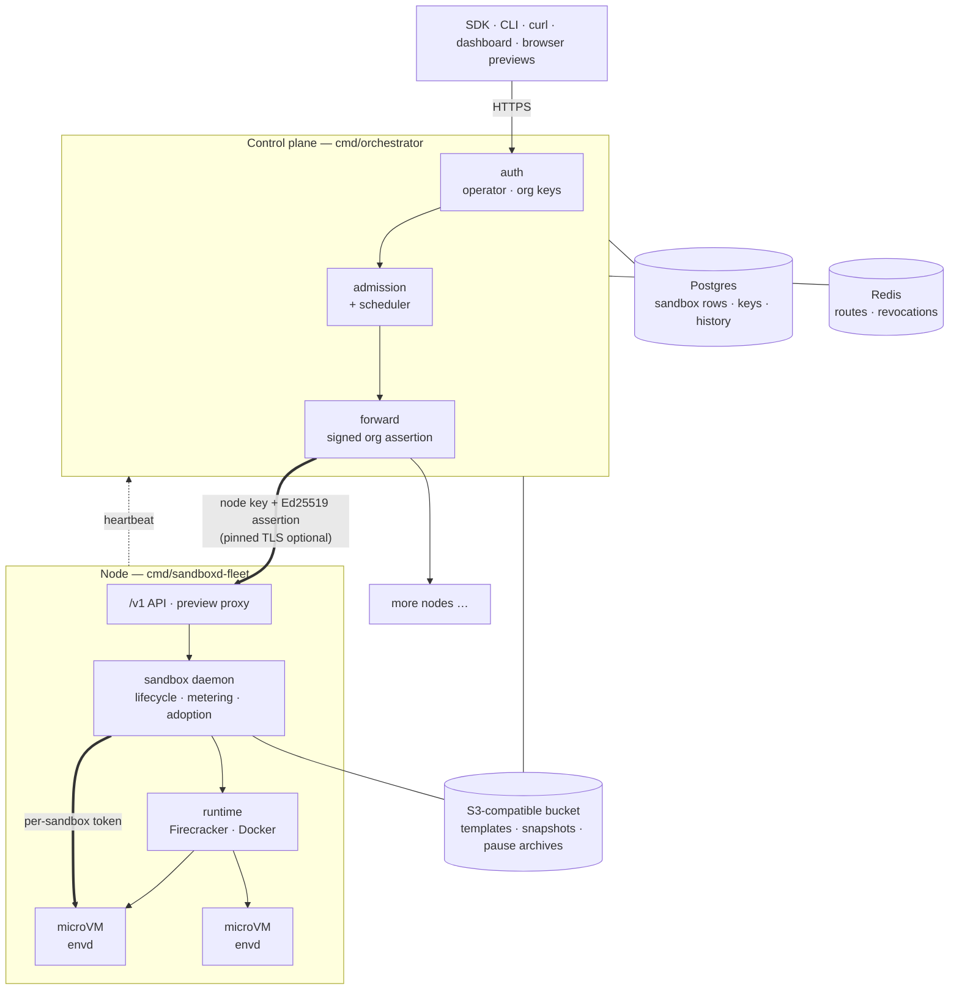

# Architecture



**Three tiers, two trust boundaries.** The control plane is trusted. A node is
trusted to host workloads but gets only what it needs: it cannot read tenants'
stored secrets, and its database role says so. Everything inside a sandbox is
untrusted, including `envd`, the small agent in each guest that runs commands
and moves files. Each crossing (client → control plane → node → guest) carries
its own credential, never a network position. A CI guard
(`scripts/tier-boundary-guard.sh`) fails the build if a package imports across
a tier it should not.

**A request, end to end.** `POST /v1/sandboxes` is authenticated and resolved
to an org, checked against the org's limits, and placed on the node with the
best fit that is not CPU-hot. It is forwarded with an assertion signed for that
node, method and path, which the node verifies and refuses to accept twice. The
node boots the sandbox from a golden snapshot of its template (tens of
milliseconds) or a cold boot (about a second) and returns an id, URLs and a
token. Every later call on that id is routed to the node that owns it.

**How a sandbox outlives its machine.** A pause writes the VM's memory, device
state and disk. With `SNAPSHOT_ARCHIVE=bucket` it is also archived: blocks of
zeros are skipped, the root image is referenced by hash, and a manifest is
written last so a half-written archive is never used. The archive's id is
recorded on the sandbox's row, and any later save clears it, so only the
latest pause can ever be restored. When the control plane reaps a dead node,
its paused sandboxes stay paused. The first request for one asks a healthy node
to *rehome* it: that node pulls the manifest and state and starts the VM with
its memory served on demand over userfaultfd, while the rest streams in behind
it.

**Single node or fleet, same code.** `cmd/sandboxd` is the whole thing in one
process: node, store (SQLite or Postgres), preview proxy and dashboard.
`cmd/orchestrator` plus any number of `cmd/sandboxd-fleet` nodes is the
clustered form. Both node binaries share `internal/nodeboot`.

Go deeper: [runtimes](runtimes.md) (what each runtime isolates) and the
[deployment runbook](deployment.md) (every setting, and how nodes, TLS,
storage and node loss fit together).

## Repository layout

```
cmd/
  sandboxd/        single-node server: node + store + proxy + dashboard
  sandboxd-fleet/  fleet node agent (no web UI)
  orchestrator/    control plane: auth, admission, scheduling, forwarding, dashboard
  envd/            in-guest agent: exec, files, terminal
  agentd/          in-guest supervisor for agent templates
  devserver/       development server behind `make dev` (local, unisolated runtime)
  pilldrops-join/  node bootstrap used by a join token
  pilldrops-bench/ latency and density benchmarks
  setplan/         assign a limit preset to an org
  gendocs/         generates docs/agent from the OpenAPI document
internal/
  httpapi/         the node's /v1 API
  orchestrator/    the control plane's API, forwarding and background jobs
  cluster/         node registry and best-fit scheduler
  sandbox/daemon/  sandbox lifecycle, metering, pause archives, rehome
  runtime/         runtime adapters: firecracker, docker, process
  vm/              Firecracker engine: jailer, snapshots, networking, lazy memory
  artifact/        object storage: S3, packed block format, cache
  egress/, egressproxy/   outbound policy
  store/           SQLite / Postgres, versioned migrations
  proxy/           preview reverse proxy
  extras/          optional features (AI agent, chat bridges, functions); the
                   engine never imports them
templates/         sandbox image recipes
web/               dashboard source
cli/               older Python CLI (the maintained CLI is pilldrops-oss/pilldrops-cli)
agent/             a small Python coding agent that drives sandboxes (example)
action/            GitHub Action: run a command in a sandbox from a workflow
examples/          API and SDK examples
tests/             contract tests against a live deployment, CLI and e2e tests
install/, packaging/  node installer and systemd units
scripts/           host provisioning, template builds, CI guards
proto/             envd's gRPC protocol
docs/              documentation, indexed in docs/README.md
```
